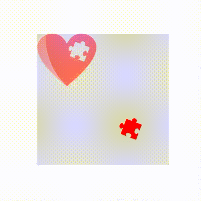
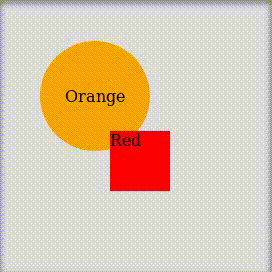
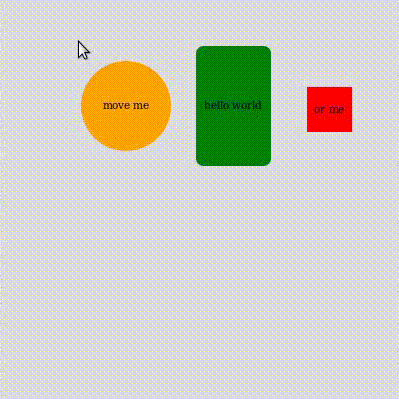

# panzoom-core

[](https://www.npmjs.com/package/panzoom-core)
[](https://www.npmjs.com/package/panzoom-core)
[](https://bundlephobia.com/package/panzoom-core)
[](#)
[](LICENSE)

> A lightweight, framework-agnostic library for **pan & zoom** with first-class support for **moving**, **resizing** and **selecting** elements inside the viewport.



Zero runtime dependencies. Works with plain DOM — no React required — while powering higher-level wrappers such as [`@sasza/react-panzoom`](https://www.npmjs.com/package/@sasza/react-panzoom).

## Features

- 🖐️ **Pan** with mouse drag or touch
- 🔍 **Zoom** with the wheel or pinch gestures
- 🧲 **Movable elements** with families & followers for grouped dragging
- ↔️ **Axis locking** — restrict element movement to horizontal or vertical only
- 📐 **Resizable elements** (horizontal and/or vertical)
- 🎯 **Selecting mode** for marquee-selecting multiple elements
- 🧱 **Boundaries** with support for dynamic expressions
- 🚀 **Auto-move at edge** while dragging near the viewport border
- 📦 **Framework-agnostic** — pure DOM API, ships ESM + CJS + TypeScript types

## Demos

| Demo | Link |
| --- | --- |
| Basic | https://codesandbox.io/s/quiet-snow-qldnic |
| Map with pin | https://codesandbox.io/s/black-sound-vn77k9 |
| Example from preview | https://codesandbox.io/s/young-darkness-igcf67 |
| Selecting elements | https://codesandbox.io/s/gifted-pine-dhw9m6 |
| Tic Tac Toe | https://codesandbox.io/s/festive-matsumoto-ccskw0 |

**Built on top of panzoom-core:**
[react-web-builder](https://www.npmjs.com/package/react-web-builder) ·
[react-grid-panzoom](https://www.npmjs.com/package/react-grid-panzoom) ·
[@sasza/react-panzoom](https://www.npmjs.com/package/@sasza/react-panzoom) ·
[react-drawing](https://www.npmjs.com/package/react-drawing)

## Installation

```bash
npm install panzoom-core
# or
pnpm add panzoom-core
# or
yarn add panzoom-core
```

## Quick start

```tsx
import initializePanZoom from 'panzoom-core'

const node = document.querySelector('[data-id="panzoom"]')
const panZoom = initializePanZoom(node, {
  zoomMin: 0.5,
  zoomMax: 4,
  boundary: true,
})
```

```html
<div>
  <div data-id="panzoom"></div>
</div>
```

The element passed to `initializePanZoom` becomes the **container**. Its first child becomes the **child node** that is actually panned and zoomed.

## Options

Pass these to `initializePanZoom(node, options)` or update them later with `panZoom.setOptions(options)`.

| Name | Type | Default | Description |
| --- | --- | --- | --- |
| `boundary` | `{ top, right, bottom, left }` \| `boolean` | `false` | Restrict panning. Values are numbers in px, or expressions like `{ top: 'childHeight - containerHeight - 100px' }`. Pass `true` to clamp to the child bounds. |
| `className` | `string` | `undefined` | Custom class name applied to the container. |
| `disabled` | `boolean` | `false` | Disable pan **and** zoom. |
| `disabledElements` | `boolean` | `false` | Disable moving of all elements. |
| `disabledMove` | `boolean` | `false` | Disable panning (zoom still works). |
| `disabledScrollHorizontal` | `boolean` | `false` | Disable horizontal panning. |
| `disabledScrollVertical` | `boolean` | `false` | Disable vertical panning. |
| `disabledUserSelect` | `boolean` | `false` | Prevent text/CSS selection while interacting. |
| `disabledZoom` | `boolean` | `false` | Disable zooming. |
| `elementsAutoMoveAtEdge` | `boolean` | `false` | Auto-pan the viewport when dragging an element near the edge. |
| `height` | `string` \| `number` | `100%` | Height of the child container. |
| `onContainerChange` | `func` | `null` | Fired on move **or** zoom. Receives `{ position, zoom }`. |
| `onContainerClick` | `func` | `null` | Fired on mousedown/touchstart. Receives `{ e, stop, x, y }`. Same trigger as `onContainerPressStart`. |
| `onContainerPressStart` | `func` | `null` | Fired on mousedown/touchstart. Receives `{ e, stop, x, y }`. |
| `onContainerPressEnd` | `func` | `null` | Fired on mouseup/touchend/touchcancel. Receives `{ e, x, y }`. |
| `onContainerPositionChange` | `func` | `null` | Fired on position change. Receives `{ position, zoom }`. |
| `onContainerZoomChange` | `func` | `null` | Fired on zoom change. Receives `{ position, zoom }`. |
| `onContextMenu` | `func` | `null` | Fired on right click. Receives `{ e, x, y }`. |
| `onElementsChange` | `func` | `null` | Fired when any element changes position. Receives a map of `{ [id]: { x, y } }`. |
| `scrollSpeed` | `number` | `1` | Panning speed multiplier. |
| `selecting` | `boolean` | `false` | Switch to marquee selecting mode. See [Selecting](#selecting). |
| `width` | `string` \| `number` | `100%` | Width of the child container. |
| `zoomInitial` | `number` | `1` | Initial zoom value. |
| `zoomMax` | `number` | `5` | Maximum zoom. |
| `zoomMin` | `number` | `0.3` | Minimum zoom. |
| `zoomPosition` | `{ x, y }` \| `null` | `null` | Anchor point for zooming. `x`/`y` are numbers or `'center'`. |
| `zoomSpeed` | `number` | `1` | Zoom speed on wheel events. |

### Boundary expressions

`boundary` accepts plain px numbers, or string expressions built from a small set of variables and the `+` / `-` operators. This is useful when the boundary should depend on the size of the container or the child content:

```tsx
initializePanZoom(node, {
  boundary: {
    top: 0,
    left: 0,
    right: 'childWidth - containerWidth',
    bottom: 'childHeight - containerHeight - 100px',
  },
})
```

Available variables:

| Variable | Meaning |
| --- | --- |
| `containerWidth` | Width of the container (viewport). |
| `containerHeight` | Height of the container (viewport). |
| `childWidth` | Width of the panned child content. |
| `childHeight` | Height of the panned child content. |

> Only `+` and `-` are supported, and numbers may carry a `px` suffix (e.g. `'childWidth - 100px'`). Passing `boundary: true` clamps panning to the child bounds automatically.

## Events

All callbacks are passed to `initializePanZoom` (or `setOptions`). Container events receive the current `{ position, zoom }`; element events receive the element's `id`, `family` and current `{ x, y }`.

```tsx
initializePanZoom(node, {
  onContainerChange: ({ position, zoom }) => {
    console.log('viewport moved or zoomed', position, zoom)
  },
  onContainerPressStart: ({ e, stop, x, y }) => {
    // call stop() to prevent panning from starting
  },
  onContainerPressEnd: ({ e, x, y }) => {
    // fired when the mouse/touch is released
  },
  onElementsChange: (elements) => {
    // elements is a map: { [id]: { x, y } }
    Object.entries(elements).forEach(([id, pos]) => {
      console.log(id, pos.x, pos.y)
    })
  },
})

panZoom.addElement(node, {
  id: 'a',
  onClick: ({ id, family, e, stop, x, y }) => {
    // stop() cancels the drag that would otherwise start
  },
  onMouseUp: ({ id, x, y }) => {
    console.log('dropped', id, 'at', x, y)
  },
})
```

## API

```tsx
import initializePanZoom from 'panzoom-core'

const node = document.querySelector('[data-id="panzoom"]')
const panZoom = initializePanZoom(node, options)
```

| Method | Description |
| --- | --- |
| `setOptions(options)` | Update panzoom options. |
| `addElement(node, elementOptions)` → `ElementApi` | Register a new movable/resizable element. |
| `move(x, y)` | Add `x`/`y` (px) to the current offset. |
| `getElements()` | Return the map of registered elements. |
| `getElementsInMove()` | Return the elements currently being dragged. |
| `grabElement(id, position?)` | Programmatically start dragging an element. Returns a release fn (or `null`). |
| `updateElementPosition(id, position)` | Move an element and fire change events. |
| `updateElementPositionSilent(id, position)` | Move an element **without** firing change events. |
| `goBackToBoundary()` | Snap the viewport back inside the configured boundary. |
| `getPosition()` → `{ x, y }` | Return the current pan offset. |
| `setPosition(x, y)` | Set the pan offset. |
| `getZoom()` → `number` | Return the current zoom. |
| `setZoom(zoom)` | Set the zoom. |
| `zoomIn(zoom)` | Add to the current zoom (negative values zoom out). |
| `zoomOut(zoom)` | Subtract from the current zoom. |
| `childNode` | The panned/zoomed child node. |
| `reset()` | Reset position and zoom to `(0, 0, 0)`. |
| `destroy()` | Tear down the instance and remove listeners. |

## Elements



```tsx
import initializePanZoom from 'panzoom-core'

const node = document.querySelector('[data-id="panzoom"]')
const panZoom = initializePanZoom(node, options)

const elementA = panZoom.addElement(
  document.querySelector('[data-id="element-a"]'),
  { id: 'a' },
)

const elementB = panZoom.addElement(
  document.querySelector('[data-id="element-b"]'),
  { id: 'b', x: 100, y: 100 },
)
```

```html
<div>
  <div data-id="panzoom">
    <div data-id="element-a">test</div>
    <div data-id="element-b">move me</div>
  </div>
</div>
```

`addElement` returns an `ElementApi`:

| Method | Description |
| --- | --- |
| `setOptions(options)` | Update the element's options. |
| `destroy()` | Remove the element from panzoom. |

### Element properties

| Name | Type | Default | Description |
| --- | --- | --- | --- |
| `id` \* | `string` \| `number` | `undefined` | **Required.** Unique element ID. |
| `className` | `string` | `undefined` | Class name applied to the element. |
| `disabled` | `boolean` | `false` | Disable the element entirely. |
| `disabledMove` | `boolean` | `false` | Disable moving this element. |
| `disabledMoveHorizontal` | `boolean` | `false` | Lock movement on the X axis (only vertical dragging allowed). |
| `disabledMoveVertical` | `boolean` | `false` | Lock movement on the Y axis (only horizontal dragging allowed). |
| `draggableSelector` | `string` | `undefined` | Only start dragging when the event target matches this selector (drag handle). |
| `family` | `string` | `undefined` | Group name — elements sharing a family move together. |
| `followers` | `Array<string \| number>` | `[]` | Like `family`, but for explicit element IDs. |
| `onClick` | `func` | `null` | Fired on element mousedown. Receives `{ id, family, e, stop, x, y }`. |
| `onContextMenu` | `func` | `null` | Fired on element right click. Receives `{ id, family, e, x, y }`. |
| `onMouseUp` | `func` | `null` | Fired on element mouseup. Receives `{ id, family, e, x, y }`. |
| `x` | `number` | `0` | Initial X position of the element. |
| `y` | `number` | `0` | Initial Y position of the element. |
| `width` | `number` | `undefined` | Element width in px. |
| `height` | `number` | `undefined` | Element height in px. |
| `zIndex` | `number` | `undefined` | Fixed z-index. When omitted, the element is auto-raised on drag. |

#### Resizing

| Name | Type | Default | Description |
| --- | --- | --- | --- |
| `resizable` | `boolean` | `false` | Enable horizontal resizing. |
| `resizerWidth` | `number` | `undefined` | Width of the horizontal resize handle. |
| `resizedMinWidth` | `number` | `undefined` | Minimum width when resizing. |
| `resizedMaxWidth` | `number` | `undefined` | Maximum width when resizing. |
| `resizableVertical` | `boolean` | `false` | Enable vertical resizing. |
| `resizerHeight` | `number` | `undefined` | Height of the vertical resize handle. |
| `resizedMinHeight` | `number` | `undefined` | Minimum height when resizing. |
| `resizedMaxHeight` | `number` | `undefined` | Maximum height when resizing. |
| `onStartResizing` | `func` | `null` | Fired when resizing begins. Receives `{ id }`. |
| `onAfterResize` | `func` | `null` | Fired when resizing ends. Receives `{ id }`. |

\* required

### Locking movement to a single axis

Use `disabledMoveHorizontal` / `disabledMoveVertical` to constrain how an element can be dragged — handy for sliders, timelines or lanes.

```tsx
// Element can only move up and down
panZoom.addElement(node, { id: 'vertical-slider', disabledMoveHorizontal: true })

// Element can only move left and right
panZoom.addElement(node, { id: 'horizontal-slider', disabledMoveVertical: true })
```

### Family vs followers

Both group elements so they move together, but they express the relationship differently:

- **`family`** — a shared, symmetric group name. Dragging **any** element in the family moves **all** of them. Great for clusters that should always travel together.
- **`followers`** — a directed, one-way list of IDs on a single element. Dragging that element also moves its followers, but dragging a follower on its own does **not** move the leader.

```tsx
// Symmetric group — drag any of them, all move
panZoom.addElement(nodeA, { id: 'a', family: 'group-1' })
panZoom.addElement(nodeB, { id: 'b', family: 'group-1' })

// One-way — dragging 'leader' also moves 'child-1' and 'child-2',
// but dragging 'child-1' alone moves only itself
panZoom.addElement(nodeLeader, { id: 'leader', followers: ['child-1', 'child-2'] })
panZoom.addElement(nodeChild1, { id: 'child-1' })
panZoom.addElement(nodeChild2, { id: 'child-2' })
```

## TypeScript

The package ships with full type definitions — no `@types` package required. The public entry exports `PanZoomOptions`, `ElementOptions` and `API`; the instance and element handles are inferred from the return values:

```tsx
import initializePanZoom, {
  type PanZoomOptions,
  type ElementOptions,
} from 'panzoom-core'

const options: PanZoomOptions = { zoomMin: 0.5, boundary: true }

// panZoom and element are fully typed via inference
const panZoom = initializePanZoom(node, options)

const elementOptions: ElementOptions = { id: 'a', x: 100, y: 100 }
const element = panZoom.addElement(node, elementOptions)
```

## Selecting

```tsx
import initializePanZoom from 'panzoom-core'

const panZoom = initializePanZoom(node, { selecting: true })

// disable later:
panZoom.setOptions({ selecting: false })
```



## Development

```bash
pnpm i        # install dependencies
pnpm dev      # run the interactive examples (Ladle)
pnpm test     # run the test suite (Vitest)
pnpm coverage # run tests with coverage
pnpm build    # build the library
pnpm lint     # lint & auto-fix
```

The library is covered by an extensive Vitest suite (~99% statement/line, ~98% branch coverage). Run `pnpm coverage` to generate a fresh report.

## License

[MIT](LICENSE) © sasza
